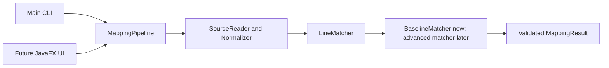

# Architecture and shared contracts

## Implemented foundation

Java 17, Maven, JUnit 5 and a plain Java core with no JavaFX dependency. Flow:

Package: `edu.comp3110.linetracker`. Production code is under `src/main/java`; JUnit tests under `src/test/java`; shared development examples under `datasets/development`.

| Component | Contract | Ongoing owner |
| --- | --- | --- |
| SourceReader / Normalizer | UTF-8 files to original-numbered comparison lines | Ali |
| SourceLine / SourceFile | Immutable original text plus normalized comparison text | Ali coordinates changes with team |
| LineMatcher | `match(SourceFile oldFile, SourceFile newFile, MatchConfig config)` | Ayden |
| BaselineMatcher | Ordered normalized-equality LCS with stable old-first ties | Ayden |
| ContentSimilarity | `score(String left, String right)`; 1 minus normalized Levenshtein distance | Ayden |
| MappingPipeline | `compare(Path oldPath, Path newPath, MatchConfig config)`; loads, delegates, validates | Ali |
| Main | Baseline CLI, plain line-pair output and meaningful error codes | Ali |
| Future JavaFX UI | Calls same pipeline in a background task | Aadi |
| Future evaluator | Compares predicted and manually verified mappings | Mujtaba |

Ayden authored this initial foundation to unblock development. Ownership above describes future responsibility, not authorship attribution.

## Records and invariants

- `SourceLine(int number, String original, String normalized)` uses one-based original positions.
- `SourceFile(String path, List<SourceLine> lines)` requires consecutive original line numbers, starting at 1. `fromLines` builds valid comparison copies.
- `Match(List<Integer> oldLines, List<Integer> newLines, MatchKind kind, double score)` has one old line and one new line, or one old line and multiple consecutive new lines for SPLIT. Score is finite in [0,1], not a probability.
- `MatchKind`: UNCHANGED, MODIFIED, MOVED, SPLIT. Only UNCHANGED is currently produced. Serialization should use lowercase names to match the dataset schema.
- `MappingResult(List<Match> matches, List<Integer> deleted, List<Integer> added, MatchConfig config)` copies its lists. Call `validate(oldCount,newCount)` to enforce line bounds, complete coverage and exclusive ownership. MappingPipeline validates matcher results before returning.
- `deleted` / `added` mean unmatched old/new lines at the current stage. Modified-line candidates remain in these lists until advanced matching resolves them. Match order from the baseline is increasing by original line number.
- `MatchConfig(long maxLcsCells)` defaults to 4,000,000. Add advanced settings in a coordinated change rather than silently changing the interface.

## Baseline and normalization

Read all original lines, retaining blanks and original text. A terminal newline does not create a phantom additional line. Normalize using strip, Unicode whitespace collapse and Locale.ROOT lowercase; punctuation/comments remain. This deliberately ignores case/spacing, including within literals, and can hide meaningful changes. UNCHANGED means comparison equality only.

BaselineMatcher computes an LCS of normalized lines. On tied alternatives it advances the old-file cursor first, making repeated-line results deterministic. Each resulting match has score 1. Remaining old/new line numbers are explicitly returned. Empty files are handled directly. Nonempty files exceeding the configured LCS cell budget fail before table allocation. This is an LCS baseline, not a claim of exact Unix diff/LHDiff reproduction.

ContentSimilarity accepts comparison strings and calculates `1 - distance/max(lengths)`. Empty/empty is 1, one empty is 0. Inputs are Java UTF-16 code units; memory is O(min(lengths)), time O(length1*length2). The baseline does not greedily map similar edited lines yet.

## Next matching stages — Ayden Tasks 2–3

Use stable SimHash for content/context to rank up to 15 new candidates per unmatched old line. Context uses up to four original lines above/below, excluding the current line. Re-score with content Levenshtein and context token-frequency cosine, starting at 0.6/0.4 weights. Define tokenization, zero-vector behavior, threshold and deterministic ties before integration. Select nonconflicting mappings, then detect splits by concatenating consecutive new lines while normalized distance improves. Do not reuse lines consumed by other groups. Tune on development data only; freeze settings before final evaluation.

## JavaFX — Aadi

Use `edu.comp3110.linetracker.ui` for future UI classes. Select old/new files, compare, display original text with line numbers and highlight all selected mapping lines, then export through Ali's formatter. Include labels alongside colors, errors and empty-result states. Clear stale results when inputs change. Run matching in a JavaFX Task; keep the core independent of JavaFX. Pin compatible JavaFX dependencies when implementing. CLI/GUI equivalence is required once integrated.

## Bug tracing — Ayden and Ali

Confirm whether required on Nov 3. If mandatory, start a small verified history example in Task 2 rather than waiting until the end. Compare a known bug-fix commit with its parent, identify pre-fix lines, trace backward and report candidate introducing commits with evidence. Initially restrict merge/rename complexity explicitly. Keywords alone do not establish that a commit fixes a bug or proves causation.

## Verification and handoffs

JUnit covers identical/blank/empty files, insertions/deletions with original numbering, entirely edited unmatched lines, stable duplicates, locale-independent normalization, known similarity values, invalid mapping coverage, split-shaped contracts, memory guards, UTF-8/CRLF input and CLI errors. CI runs Maven verify. The GUI, advanced matching, JSON export and real dataset evaluation cannot be validated until implemented. Development fixtures are synthetic and require teammate review; no benchmark accuracy claims are made.
