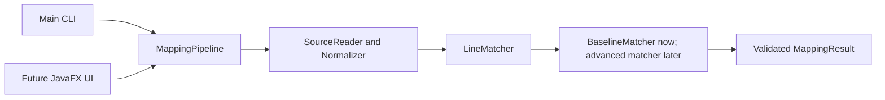

# Architecture and shared contracts

## Implemented foundation

Java 17, Maven, JUnit 5 and a plain Java core with no JavaFX dependency. Flow:



Package: `edu.comp3110.linetracker`. Production code is under `src/main/java`; JUnit tests under `src/test/java`; shared development examples under `datasets/development`.

| Component | Contract | Ongoing owner |
| --- | --- | --- |
| SourceReader / Normalizer | UTF-8 files to original-numbered comparison lines | Ali |
| SourceLine / SourceFile | Immutable original text plus normalized comparison text | Ali coordinates changes with team |
| LineMatcher | `match(SourceFile oldFile, SourceFile newFile, MatchConfig config)` | Ayden |
| BaselineMatcher | Ordered normalized-equality LCS with stable old-first ties | Ayden |
| ContentSimilarity | `score(String left, String right)`; 1 minus normalized Levenshtein distance | Ayden |
| MappingPipeline | `compare(Path, Path, MatchConfig)` or `compare(SourceFile, SourceFile, MatchConfig)`; delegates and validates | Ali |
| TextMappingFormatter | `format(MappingResult)` returns sorted `old-new` pairs separated by `\n` | Ali |
| Main | Baseline CLI, plain line-pair output and meaningful error codes | Ali |
| Future JavaFX UI | Calls same pipeline in a background task | Aadi |
| Future evaluator | Compares predicted and manually verified mappings | Mujtaba |

Ayden authored this initial foundation to unblock development. Ownership above describes future responsibility, not authorship attribution.

Ali's Task 1 builds on that foundation with the loaded-source pipeline overload, explicit boundary validation and input-role file errors, a shared text formatter, a Unicode boundary-whitespace correction, and packaged-JAR integration checks. The foundation remains an unmerged dependency in [pull request #1](https://github.com/aydsman/comp3110-line-tracker/pull/1).

## Records and invariants

- `SourceLine(int number, String original, String normalized)` uses one-based original positions.
- `SourceFile(String path, List<SourceLine> lines)` requires consecutive original line numbers, starting at 1. `fromLines` builds valid comparison copies.
- `Match(List<Integer> oldLines, List<Integer> newLines, MatchKind kind, double score)` has one old line and one new line, or one old line and multiple consecutive new lines for SPLIT. Score is finite in [0,1], not a probability.
- `MatchKind`: UNCHANGED, MODIFIED, MOVED, SPLIT. Only UNCHANGED is currently produced. Serialization should use lowercase names to match the dataset schema.
- `MappingResult(List<Match> matches, List<Integer> deleted, List<Integer> added, MatchConfig config)` copies its lists. Call `validate(oldCount,newCount)` to enforce line bounds, complete coverage and exclusive ownership. MappingPipeline rejects null results or a result with a different config, then validates before returning.
- `deleted` / `added` mean unmatched old/new lines at the current stage. Modified-line candidates remain in these lists until advanced matching resolves them. Match order from the baseline is increasing by original line number.
- `MatchConfig(long maxLcsCells)` defaults to 4,000,000. Add advanced settings in a coordinated change rather than silently changing the interface.

These are concrete implementation contracts for teammate review, not a claim that every team member has already approved them. Retain the existing public shapes when integrating backend, UI, or evaluator work.

## Pipeline and error contract

```java
var pipeline = new MappingPipeline(new BaselineMatcher());
var config = MatchConfig.DEFAULT;

// CLI or other callers that only need the result:
MappingResult fromPaths = pipeline.compare(oldPath, newPath, config);

// A UI can keep these exact records for display and comparison:
SourceFile oldFile = SourceReader.read(oldPath);
SourceFile newFile = SourceReader.read(newPath);
MappingResult fromLoadedFiles = pipeline.compare(oldFile, newFile, config);
String textExport = TextMappingFormatter.format(fromLoadedFiles);
```

The path overload checks required arguments before file I/O, reads old then new UTF-8 input, and delegates to the loaded-source overload. A path read failure is an `IOException` identifying the old/new role, UTF-8 input and path, retaining the original exception as its cause. `SourceReader.read` remains available independently and declares `IOException`; role context is added by the path pipeline.

The loaded-source overload checks source/config arguments before invoking the matcher. It requires a non-null result with a config equal to the requested config and complete, exclusive ownership of the original source lines. Invalid matcher results are rejected instead of being displayed or exported. Null API arguments are caller errors; invalid record values and invalid mapping results are rejected. The CLI converts comparison/file failures to a readable standard-error message and exit code 1; incorrect command syntax returns 2.

`TextMappingFormatter.format` expands a split group into one pair per target line, sorts pairs by old then new line number, and returns one `old-new\n` record per pair. With no matches it returns the empty string. It emits no headers, scores, config, or unmatched-line messages. Pass a pipeline-validated result; formatting does not have source lengths and cannot establish complete coverage. The CLI uses the same formatter, while its unmatched old/new lists stay on standard error. This preserves `map OLD NEW` compatibility for Mujtaba's text-based evaluator. JSON export is Task 2 work.

## Baseline and normalization

Read all original lines, retaining blanks and original text. A terminal newline does not create a phantom additional line. Normalize Unicode whitespace runs to ordinary spaces, remove boundary spaces, and lowercase with Locale.ROOT; punctuation/comments remain. Collapsing before stripping also removes boundary non-breaking spaces, which Java's `strip` alone does not remove. This deliberately ignores case/spacing, including within literals, and can hide meaningful changes. UNCHANGED means comparison equality only.

BaselineMatcher computes an LCS of normalized lines. On tied alternatives it advances the old-file cursor first, making repeated-line results deterministic. Each resulting match has score 1. Remaining old/new line numbers are explicitly returned. Empty files are handled directly. Nonempty files exceeding the configured LCS cell budget fail before table allocation. This is an LCS baseline, not a claim of exact Unix diff/LHDiff reproduction.

ContentSimilarity accepts comparison strings and calculates `1 - distance/max(lengths)`. Empty/empty is 1, one empty is 0. Inputs are Java UTF-16 code units; memory is O(min(lengths)), time O(length1*length2). The baseline does not greedily map similar edited lines yet.

## Next matching stages — Ayden Tasks 2–3

Use stable SimHash for content/context to rank up to 15 new candidates per unmatched old line. Context uses up to four original lines above/below, excluding the current line. Re-score with content Levenshtein and context token-frequency cosine, starting at 0.6/0.4 weights. Define tokenization, zero-vector behavior, threshold and deterministic ties before integration. Select nonconflicting mappings, then detect splits by concatenating consecutive new lines while normalized distance improves. Do not reuse lines consumed by other groups. Tune on development data only; freeze settings before final evaluation.

Ayden's separate Task 2 branch already uses the existing `LineMatcher` interface and `MappingPipeline(LineMatcher)` constructor. Its expanded `MatchConfig` retains the one-argument constructor. Integrate the advanced matcher through constructor injection, keep the requested config in its result, and rerun the same integration checks. An isolated source/API compatibility build passed with these integration changes overlaid on Task 2; see [the verification record](ALI_TASK_1.md#verification-record) for its exact revision and limits. The advanced implementation is not included in this branch.

## JavaFX — Aadi

Use `edu.comp3110.linetracker.ui` for future UI classes. Select old/new files, compare, display original text with line numbers and highlight all selected mapping lines, then export through Ali's formatter. Include labels alongside colors, errors and empty-result states. Clear stale results when inputs change. Run matching in a JavaFX Task; keep the core independent of JavaFX. Pin compatible JavaFX dependencies when implementing. CLI/GUI equivalence is required once integrated.

Use the loaded-source overload when the view must show the same snapshot that was compared. Retain `SourceLine.original()` and `number()` for the panels; comparison strings are not display text. Treat a SPLIT as one group with every `newLines()` entry selected, and treat scores as similarities, not probabilities. Surface file errors and clear stale results after a failure. Both file reading and comparison belong off the JavaFX application thread. A real GUI comparison and export-equivalence demonstration remain outstanding.

## Bug tracing — Ayden and Ali

The planned Nov 3 confirmation is still outstanding as of Nov 11, 2026. If mandatory, start a small verified history example in Task 2 rather than waiting until the end. Compare a known bug-fix commit with its parent, identify pre-fix lines, trace backward and report candidate introducing commits with evidence. Initially restrict merge/rename complexity explicitly. Keywords alone do not establish that a commit fixes a bug or proves causation.

## Verification and handoffs

Ayden's JUnit suite covers identical/blank/empty files, insertions/deletions with original numbering, entirely edited unmatched lines, stable duplicates, locale-independent normalization, known similarity values, invalid mapping coverage, split-shaped contracts, memory guards, UTF-8/CRLF input and CLI errors. Ali's additional checks exercise pipeline boundaries, shared text formatting, Unicode boundary whitespace and the actual packaged CLI. Maven Failsafe runs packaged-JAR integration tests during `verify`, after packaging; `package` alone is insufficient.

Record results for the actual reviewed revision in [Ali's Task 1 handoff](ALI_TASK_1.md) and its pull request. The GUI, advanced matching, JSON export and real dataset evaluation are outside this branch's evidence. Development fixtures are synthetic and require teammate review; no benchmark accuracy claims are made.
