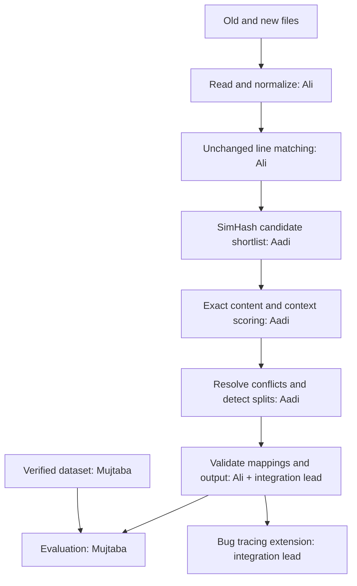

# Architecture

## Scope and approach

Build a local command-line application first. No web interface, database, or service is needed for the stated goals. Use Java 17, Maven, plain files, and explicit shared data models. Use JUnit 5 for tests. Choose and document a Java diff library or implement an LCS baseline after checking course library restrictions.

## Modules and ownership

| Module | Owner | Contract |
| --- | --- | --- |
| `SourceReader.java`, `Normalizer.java` | Ali | Load original lines, produce normalized comparison strings |
| `BaselineMatcher.java` | Ali | Return unchanged matches plus unmatched line numbers |
| `CandidateSelector.java`, `Similarity.java` | Aadi | Rank unmatched candidate pairs and calculate scores |
| `MatchResolver.java`, `SplitDetector.java` | Aadi | Produce deterministic edited/moved/split matches |
| `Evaluator.java` | Mujtaba | Compare predicted and verified mapping pairs |
| `Main.java`, `MappingPipeline.java`, model records | Integration lead | Coordinate stages and enforce shared contracts |
| `BugTracer.java` | Integration lead | Later extension using repository history |

These are planned module names; implementation files will be introduced as their tasks begin.

## Shared data contracts

Use Java records for immutable data models and typed collections; the following is a conceptual interface agreement (translate list[int] to List<Integer>, str to String, and dict to a configuration record):

- `SourceLine(number: int, original: str, normalized: str)`
- `SourceFile(path: str, lines: list[SourceLine])`
- `Match(old_lines: list[int], new_lines: list[int], kind: str, score: float)`
- `MappingResult(matches: list[Match], deleted: list[int], added: list[int], config: dict)`
- Kinds: `unchanged`, `modified`, `moved`, `split`. Define moved classification explicitly before reporting it; positional shifts alone do not prove movement.
- A normal match has one old and one new line. A split has one old and multiple consecutive new lines. Many-to-one merges are outside the initial scope pending instructor guidance.
- Each line belongs to at most one match group. Unmatched old lines are deletions; unmatched new lines are additions. All input lines must be accounted for.
- `score` is in [0, 1], with larger values indicating greater similarity; it is not a calibrated probability.

Planned stage functions: `load_source(path)`, `normalize(source, config)`, `match_unchanged(old, new)`, `build_candidates(old, new, unmatched, config)`, `resolve_matches(candidates, config)`, `detect_splits(old, new, remaining, config)`, and `evaluate(predicted, expected)`.

## Algorithm decisions to implement

1. Keep original line numbers and text. Normalize only comparison text: lowercase, trim ends, collapse internal whitespace. Preserve punctuation, comments, and blank-line positions. Document that normalization can hide case-only changes.
2. Detect unchanged normalized lines using a diff sequence matcher. Proposed baseline: an LCS-based line diff, or an approved Java diff library; verify instructor acceptance because the implementation may differ from Unix diff.
3. For unmatched lines, compute content and context fingerprints. Context uses up to four original neighboring lines above and below, excluding the current line. Never derive context from the filtered unmatched list.
4. Use deterministic tokenization, stable hashes, fixed fingerprint width, and weighted Hamming distance to rank candidates. Keep at most 15 per old line. Do not use platform-dependent or unspecified hashes for persistent fingerprints.
5. Re-score shortlisted pairs using normalized Levenshtein similarity for content and cosine similarity for token-frequency context vectors. Combined score = `0.6 * content + 0.4 * context`. Specify empty-string/vector behavior and deterministic tie-breaking.
6. Propose greedy selection by descending score, then ascending old/new line numbers, accepting only available lines above a configurable threshold. Validate conflict behavior on duplicates and repeated braces.
7. Detect splits using remaining lines and permitted tentative matches: concatenate consecutive new lines while normalized Levenshtein distance improves, then stop. Permit replacing a tentative one-to-one match only when the group improves the score and consumes no line assigned elsewhere. Bound the search and verify cases where no fragment passed the initial match threshold.
8. Sort final output by old line number, validate coverage/exclusivity, and expose text or JSON output.

## Configuration

Initial proposals: `candidate_count=15`, `context_window=4`, `content_weight=0.6`, `context_weight=0.4`, `simhash_bits=64`, `max_split_lines=5`. Threshold and tokenization are unresolved experiments. Select them using a development subset, then freeze them before final evaluation. Store all effective settings with results.

## Verification

Small fixtures must cover identical files, blank/empty files, additions, deletions, renaming, reordering, duplicate lines, line splits, whitespace/case changes, context at file boundaries, and no acceptable candidate. Check one-based bounds, deterministic output, exclusive line ownership, and complete coverage. Integration lead maintains end-to-end tests; each module owner covers their meaningful edge cases.

## Bug-tracing extension

After the base tool works: accept a repository and known bug-fix commit, compare its parent to the fix, identify changed/deleted pre-fix lines, and trace them through earlier revisions. Return candidate introducing commits with evidence, not claims of proven causation. Start with a single-parent, same-path case; document limits around renames, merge commits, mixed-purpose fixes, and refactoring. Commit keywords alone are weak evidence; manually verify selected bug fixes. Keep extension evaluation separate from line-mapping accuracy.

## Java project layout

Use Maven conventions: `src/main/java/edu/comp3110/linetracker/` for production classes, `src/test/java/edu/comp3110/linetracker/` for JUnit tests, and `src/test/resources/` for small fixtures. Plan Jackson for JSON if external libraries are allowed. Add `pom.xml`, pinned dependency versions, a Maven wrapper, and executable JAR packaging in the first implementation milestone. Planned build commands are `./mvnw test` and `./mvnw package` (`mvnw.cmd` on Windows). They are not available in this planning scaffold yet.
