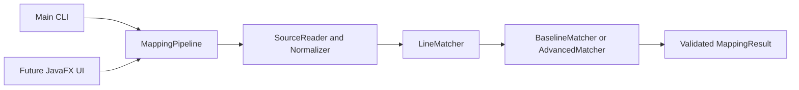

# Architecture and shared contracts

## Implemented foundation

Java 17, Maven, JUnit 5 and a plain Java core with no JavaFX dependency. Flow:



Package: `edu.comp3110.linetracker`. Production code is under `src/main/java`; JUnit tests under `src/test/java`; shared development examples under `datasets/development`.

| Component | Contract | Ongoing owner |
| --- | --- | --- |
| SourceReader / Normalizer | UTF-8 files to original-numbered comparison lines | Ali |
| SourceLine / SourceFile | Immutable original text plus normalized comparison text | Ali coordinates changes with team |
| LineMatcher | `match(SourceFile oldFile, SourceFile newFile, MatchConfig config)` | Ayden |
| BaselineMatcher | Ordered normalized-equality LCS with stable old-first ties | Ayden |
| AdvancedMatcher / SimHash | Recover edited/moved lines from unmatched candidates using content/context | Ayden |
| SplitDetector | Exact reconstruction from two through four consecutive available nonblank new lines | Ayden |
| ContentSimilarity | `score(String left, String right)`; 1 minus normalized Levenshtein distance | Ayden |
| MappingPipeline | `compare(Path, Path, MatchConfig)` or `compare(SourceFile, SourceFile, MatchConfig)`; delegates and validates | Ali |
| TextMappingFormatter | `format(MappingResult)` returns sorted `old-new` pairs separated by `\n` | Ali |
| JsonMappingFormatter | `format(MappingResult)` returns versioned prediction JSON with groups, scores, unmatched lines and config | Ali |
| Main | Selects mode/settings and exports text or JSON to stdout or a new file | Ali |
| Native CLI packaging | Bundle the verified JAR, launcher and Java 17 runtime for the target system/architecture | Ali |
| Future JavaFX UI | Calls same pipeline in a background task | Aadi |
| Future evaluator | Compares predicted and manually verified mappings | Mujtaba |

Ayden authored this initial foundation to unblock development. Ownership above describes future responsibility, not authorship attribution.

Ali's Task 1 builds on that foundation with the loaded-source pipeline overload, explicit boundary validation and input-role file errors, a shared text formatter, a Unicode boundary-whitespace correction, and packaged-JAR integration checks. The foundation remains an unmerged dependency in [pull request #1](https://github.com/aydsman/comp3110-line-tracker/pull/1).

Ali's Task 2 integrates Ayden's advanced matcher through the same interface and adds shared JSON serialization, explicit CLI settings and text/JSON file exports. Algorithm authorship remains Ayden's; integration and output are Ali's. JavaFX and QA dataset integration require separate handoffs.

Ali's Task 3 integrates Ayden's exact split detector and adds native CLI packaging with runtime/build metadata and archive smoke checks. Existing pipeline and export contracts are retained. Building an archive is distinct from testing it on its target platform or completing the GUI/course-evidence handoffs.

## Records and invariants

- `SourceLine(int number, String original, String normalized)` uses one-based original positions.
- `SourceFile(String path, List<SourceLine> lines)` requires consecutive original line numbers, starting at 1. `fromLines` builds valid comparison copies.
- `Match(List<Integer> oldLines, List<Integer> newLines, MatchKind kind, double score)` has one old line and one new line, or one old line and multiple consecutive new lines for SPLIT. Score is finite in [0,1], not a probability.
- `MatchKind`: UNCHANGED, MODIFIED, MOVED, SPLIT. The baseline produces UNCHANGED; advanced mode also produces MODIFIED, MOVED and SPLIT. JSON uses lowercase names and preserves complete groups; text expands a split into one pair per new line.
- `MappingResult(List<Match> matches, List<Integer> deleted, List<Integer> added, MatchConfig config)` copies its lists. Call `validate(oldCount,newCount)` to enforce line bounds, complete coverage and exclusive ownership. MappingPipeline rejects null results or a result with a different config, then validates before returning.
- `deleted` / `added` mean unmatched old/new lines at the current stage. Modified-line candidates remain in these lists until advanced matching resolves them. Match order from the baseline is increasing by original line number.
- `MatchConfig(long maxLcsCells, int candidateLimit, int contextRadius, double minimumScore)` retains the one-argument constructor. Defaults are 4,000,000 cells, 15 candidates, context radius 4 and minimum score 0.65. The JSON config stores these actual requested values.

These are concrete implementation contracts for teammate review, not a claim that every team member has already approved them. Retain the existing public shapes when integrating backend, UI, or evaluator work.

## Pipeline and error contract

```java
var pipeline = new MappingPipeline(new BaselineMatcher());
var config = MatchConfig.DEFAULT;

// CLI or other callers that only need the result:
MappingResult fromPaths = pipeline.compare(oldPath, newPath, config);

// A UI can keep these exact records for display and comparison:
SourceFile oldFile = SourceReader.read(oldPath);
SourceFile newFile = SourceReader.read(newPath);
MappingResult fromLoadedFiles = pipeline.compare(oldFile, newFile, config);
String textExport = TextMappingFormatter.format(fromLoadedFiles);
String jsonExport = JsonMappingFormatter.format(fromLoadedFiles);
```

The path overload checks required arguments before file I/O, reads old then new UTF-8 input, and delegates to the loaded-source overload. A path read failure is an `IOException` identifying the old/new role, UTF-8 input and path, retaining the original exception as its cause. `SourceReader.read` remains available independently and declares `IOException`; role context is added by the path pipeline.

The loaded-source overload checks source/config arguments before invoking the matcher. It requires a non-null result with a config equal to the requested config and complete, exclusive ownership of the original source lines. Invalid matcher results are rejected instead of being displayed or exported. Null API arguments throw `NullPointerException` as caller errors; invalid record values and invalid mapping results throw `IllegalArgumentException`. The CLI converts comparison/file failures to a readable standard-error message and exit code 1; incorrect syntax/settings return 2, and help returns 0.

`TextMappingFormatter.format` expands a split group into one pair per target line, sorts pairs by old then new line number, and returns one `old-new\n` record per pair. With no matches it returns the empty string. It emits no headers, scores, config, or unmatched-line messages. Pass a pipeline-validated result; formatting does not have source lengths and cannot establish complete coverage. The CLI uses the same formatter, while its unmatched old/new lists stay on standard error. This preserves `map OLD NEW` compatibility for Mujtaba's text-based evaluator.

`JsonMappingFormatter.format` emits schema version 1, preserves match groups and finite similarity scores, and includes sorted unmatched arrays and all four requested config fields. It sorts copies without mutating the result, uses locale-independent enum names/numbers, and terminates pretty JSON with LF. It serializes only model numbers and fixed names, without adding a JSON dependency or embedding source paths/text. Both formatters expect a pipeline-validated result. See [EXPORT_FORMAT.md](EXPORT_FORMAT.md) for exact fields and the difference between predictions and gold annotations.

The CLI accepts options after `OLD NEW` in any order, with each option at most once. `--format text|json` selects the shared formatter. `--output FILE` writes UTF-8 to a new file and refuses an existing destination, leaving stdout empty. `--max-lcs-cells` applies to both modes; `--candidate-limit`, `--context-radius` and `--minimum-score` require `--advanced`. Unknown, missing, duplicate or invalid options fail as usage errors. File exports and diagnostics do not alter matcher results.

## Baseline and normalization

Read all original lines, retaining blanks and original text. A terminal newline does not create a phantom additional line. Normalize Unicode whitespace runs to ordinary spaces, remove boundary spaces, and lowercase with Locale.ROOT; punctuation/comments remain. Collapsing before stripping also removes boundary non-breaking spaces, which Java's `strip` alone does not remove. This deliberately ignores case/spacing, including within literals, and can hide meaningful changes. UNCHANGED means comparison equality only.

BaselineMatcher computes an LCS of normalized lines. On tied alternatives it advances the old-file cursor first, making repeated-line results deterministic. Each resulting match has score 1. Remaining old/new line numbers are explicitly returned. Empty files are handled directly. Nonempty files exceeding the configured LCS cell budget fail before table allocation. This is an LCS baseline, not a claim of exact Unix diff/LHDiff reproduction.

ContentSimilarity accepts comparison strings and calculates `1 - distance/max(lengths)`. Empty/empty is 1, one empty is 0. Inputs are Java UTF-16 code units; memory is O(min(lengths)), time O(length1*length2). The baseline does not greedily map similar edited lines yet.

## Advanced matching (Ayden Tasks 2–3)

AdvancedMatcher retains all LCS anchors and considers the remaining nonblank lines. It builds weighted 64-bit SimHash fingerprints over normalized character trigrams and context-token counts. Context uses up to four original lines on each side, including lines already matched by LCS, and excludes the current line. Context tokens are runs of Unicode letters, marks, digits and underscores, or individual non-whitespace punctuation characters.

Each unmatched old line retains at most 15 candidates by default. Exact normalized matches rank first, then weighted Hamming distance and ascending new line number. Exact scoring uses 60% normalized Levenshtein content similarity and 40% cosine context similarity. A single empty context contributes zero similarity. If both contexts are empty, the score is content similarity. Edited proposals require content similarity of at least 0.5 and a combined score of at least 0.65 by default. These retain the defaults Ayden nominated for Task 3 evaluation; independently approved evaluation-freeze evidence is still outstanding.

Resolution accepts exact moves first, then exact split reconstructions, then fuzzy edits. Within the one-to-one stages, proposals sort by descending score, ascending old line number, then ascending new line number. Each accepted pair consumes its two lines. Exact pairs recovered outside LCS are labeled MOVED and fuzzy pairs MODIFIED. The result preserves original positions, is sorted by old line number, and accounts for every line exactly once. Candidate pruning and greedy resolution can miss a valid match. Both modes retain the baseline LCS memory guard.

Call the shared pipeline with AdvancedMatcher or run the CLI with --advanced. Existing calls and the one-argument MatchConfig constructor keep their behavior. Candidate limit, context radius and minimum combined score are configurable in MatchConfig.

## Split detection (Ayden Task 3)

After retaining the LCS anchors and resolving exact moves, the matcher checks each remaining old line for two to four consecutive, nonblank, available new lines. The fragments must reconstruct the normalized old line exactly. A break can replace one normalized space or occur directly between characters. An anchor, a move, a previously consumed fragment, or a blank line ends the candidate range.

Old lines are considered in ascending order. If multiple ranges reconstruct a line, choose the nearest starting line, then the earlier start on a tie. A successful reconstruction consumes its complete range before fuzzy proposals are accepted. The result uses SPLIT with score 1 and the CLI emits each original one-based pair. The shared result validator checks exclusive line ownership and complete coverage.

The code fixes the split cap at four and retains Task 2 defaults: 15 candidates, four context lines per side, 0.65 minimum combined score, 0.5 minimum content score, and 60/40 content/context weights. Ayden's source documents call these settings frozen; that records the implementation choice, not independent team approval or completed evaluation. Regressions cover exact reconstruction, spaces at breakpoints, conflicts, anchors, exact moves, blanks, size limits, and CLI output. This implementation targets line wrapping without further edits; it does not provide fuzzy split reconstruction or many-to-one merging. The split cap is a code constant, not a `MatchConfig` or CLI field.

Ayden's Task 2 and Task 3 implementations use the existing `LineMatcher` interface and `MappingPipeline(LineMatcher)` constructor. Existing baseline calls and the one-argument `MatchConfig` constructor remain available. Backend results retain the requested config and pass the same coverage checks. [Ali's Task 1 verification record](ALI_TASK_1.md#verification-record) describes the earlier isolated API compatibility check; current integration and package results must be recorded for their actual submitted revisions separately.

## Native CLI packaging — Ali Task 3

The packaging workflow starts from a clean-checkout Maven `verify` build and bundles its JAR with a native Java 17 `java.base` runtime created by `jlink`. It includes platform launchers, synthetic examples, usage instructions, runtime legal notices and build metadata identifying the commit, dirty state, JDK, target system/architecture and JAR checksum. macOS/Linux archives preserve executable permissions using tar.gz; Windows uses ZIP. Each bundle is built and tested on its own target platform.

Archive smoke checks exercise the extracted launcher from a separate directory with no system Java available, including text/JSON, advanced split groups, exports and error codes. See [PACKAGING.md](PACKAGING.md) for the pinned build toolchain, clean-checkout commands and exact checks. The distribution supplies the CLI. A real JavaFX frontend, a reviewed release and confirmation of whether bug tracing is mandatory remain outstanding. No native-platform success follows merely from adding the packaging scripts.

## JavaFX — Aadi

Use `edu.comp3110.linetracker.ui` for future UI classes. Select old/new files, compare, display original text with line numbers and highlight all selected mapping lines, then export through Ali's text or JSON formatter. Include labels alongside colors, errors and empty-result states. Clear stale results when inputs change. Run matching in a JavaFX Task; keep the core independent of JavaFX. Pin compatible JavaFX dependencies when implementing. CLI/GUI equivalence is required once integrated.

Use the loaded-source overload when the view must show the same snapshot that was compared. Retain `SourceLine.original()` and `number()` for the panels; comparison strings are not display text. Treat a SPLIT as one group with every `newLines()` entry selected, and treat scores as similarities, not probabilities. Surface file errors and clear stale results after a failure. Both file reading and comparison belong off the JavaFX application thread. A real GUI comparison and export-equivalence demonstration remain outstanding.

## Bug tracing — Ayden and Ali

The planned Nov 3 confirmation is still outstanding as of Nov 11, 2026. If mandatory, start a small verified history example in Task 2 rather than waiting until the end. Compare a known bug-fix commit with its parent, identify pre-fix lines, trace backward and report candidate introducing commits with evidence. Initially restrict merge/rename complexity explicitly. Keywords alone do not establish that a commit fixes a bug or proves causation.

## Verification and handoffs

Ayden's JUnit suites cover the baseline, advanced edited/moved recovery, exact splits, candidate pruning, deterministic conflicts and compatibility. Ali's checks exercise pipeline boundaries, shared text/JSON formatting, locale independence, Unicode boundary whitespace and the actual packaged CLI. JSON tests include empty/unmatched results, all match kinds, split preservation, settings and deterministic sorting without mutating input. Maven Failsafe runs packaged-JAR integration tests during `verify`, after packaging; `package` alone is insufficient. Native archive checks follow packaging and must be recorded separately.

Record integration and native-package results for the actual reviewed Task 3 revision in its pull request; prior evidence remains in [the Task 1 handoff](ALI_TASK_1.md) and [Task 2 handoff](ALI_TASK_2.md). The GUI and real dataset evaluation are outside this branch's evidence. Development fixtures are synthetic and require teammate review; no benchmark accuracy claims are made. Mujtaba's existing evaluator reads default baseline text only and cannot select the advanced CLI flag without its own update.
