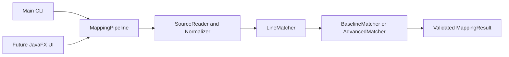

# Architecture and shared contracts

## Implemented foundation

Java 17, Maven, JUnit 5 and a plain Java core with no JavaFX dependency. Flow:

Package: `edu.comp3110.linetracker`. Production code is under `src/main/java`; JUnit tests under `src/test/java`; shared development examples under `datasets/development`.

| Component | Contract | Ongoing owner |
| --- | --- | --- |
| SourceReader / Normalizer | UTF-8 files to original-numbered comparison lines | Ali |
| SourceLine / SourceFile | Immutable original text plus normalized comparison text | Ali coordinates changes with team |
| LineMatcher | `match(SourceFile oldFile, SourceFile newFile, MatchConfig config)` | Ayden |
| BaselineMatcher | Ordered normalized-equality LCS with stable old-first ties | Ayden |
| ContentSimilarity | `score(String left, String right)`; 1 minus normalized Levenshtein distance | Ayden |
| MappingPipeline | `compare(Path oldPath, Path newPath, MatchConfig config)`; loads, delegates, validates | Ali |
| Main | Baseline CLI, plain line-pair output and meaningful error codes | Ali |
| Future JavaFX UI | Calls same pipeline in a background task | Aadi |
| Future evaluator | Compares predicted and manually verified mappings | Mujtaba |

Ayden authored this initial foundation to unblock development. Ownership above describes future responsibility, not authorship attribution.

## Records and invariants

- `SourceLine(int number, String original, String normalized)` uses one-based original positions.
- `SourceFile(String path, List<SourceLine> lines)` requires consecutive original line numbers, starting at 1. `fromLines` builds valid comparison copies.
- `Match(List<Integer> oldLines, List<Integer> newLines, MatchKind kind, double score)` has one old line and one new line, or one old line and multiple consecutive new lines for SPLIT. Score is finite in [0,1], not a probability.
- `MatchKind`: UNCHANGED, MODIFIED, MOVED, SPLIT. The baseline produces UNCHANGED. Advanced matching also produces MODIFIED, MOVED, and SPLIT. Serialization should use lowercase names to match the dataset schema.
- `MappingResult(List<Match> matches, List<Integer> deleted, List<Integer> added, MatchConfig config)` copies its lists. Call `validate(oldCount,newCount)` to enforce line bounds, complete coverage and exclusive ownership. MappingPipeline validates matcher results before returning.
- `deleted` / `added` mean unmatched old/new lines at the current stage. Modified-line candidates remain in these lists until advanced matching resolves them. Match order from the baseline is increasing by original line number.
- `MatchConfig(long maxLcsCells)` defaults to 4,000,000 cells. The expanded constructor also accepts candidateLimit, contextRadius and minimumScore.

## Baseline and normalization

Read all original lines, retaining blanks and original text. A terminal newline does not create a phantom additional line. Normalize using strip, Unicode whitespace collapse and Locale.ROOT lowercase; punctuation/comments remain. This deliberately ignores case/spacing, including within literals, and can hide meaningful changes. UNCHANGED means comparison equality only.

BaselineMatcher computes an LCS of normalized lines. On tied alternatives it advances the old-file cursor first, making repeated-line results deterministic. Each resulting match has score 1. Remaining old/new line numbers are explicitly returned. Empty files are handled directly. Nonempty files exceeding the configured LCS cell budget fail before table allocation. This is an LCS baseline, not a claim of exact Unix diff/LHDiff reproduction.

ContentSimilarity accepts comparison strings and calculates `1 - distance/max(lengths)`. Empty/empty is 1, one empty is 0. Inputs are Java UTF-16 code units; memory is O(min(lengths)), time O(length1*length2). The baseline does not greedily map similar edited lines yet.

## Advanced matching (Ayden Task 2)

AdvancedMatcher retains all LCS anchors and considers the remaining nonblank lines. It builds weighted 64-bit SimHash fingerprints over normalized character trigrams and context-token counts. Context uses up to four original lines on each side, including lines already matched by LCS, and excludes the current line. Context tokens are runs of Unicode letters, marks, digits and underscores, or individual non-whitespace punctuation characters.

Each unmatched old line retains at most 15 candidates by default. Exact normalized matches rank first, then weighted Hamming distance and ascending new line number. Exact scoring uses 60% normalized Levenshtein content similarity and 40% cosine context similarity. A single empty context contributes zero similarity. If both contexts are empty, the score is content similarity. Edited proposals require content similarity of at least 0.5 and a combined score of at least 0.65 by default. These values are frozen for the Task 3 evaluation.

Resolution accepts exact moves first, then exact split reconstructions, then fuzzy edits. Within the one-to-one stages, proposals sort by descending score, ascending old line number, then ascending new line number. Each accepted pair consumes its two lines. Exact pairs recovered outside LCS are labeled MOVED and fuzzy pairs MODIFIED. The result preserves original positions, is sorted by old line number, and accounts for every line exactly once. Candidate pruning and greedy resolution can miss a valid match. Both modes retain the baseline LCS memory guard.

Call the shared pipeline with AdvancedMatcher or run the CLI with --advanced. Existing calls and the one-argument MatchConfig constructor keep their behavior. Candidate limit, context radius and minimum combined score are configurable in MatchConfig.

## Split detection (Ayden Task 3)

After retaining the LCS anchors and resolving exact moves, the matcher checks each remaining old line for two to four consecutive, nonblank, available new lines. The fragments must reconstruct the normalized old line exactly. A break can replace one normalized space or occur directly between characters. An anchor, a move, a previously consumed fragment, or a blank line ends the candidate range.

Old lines are considered in ascending order. If multiple ranges reconstruct a line, choose the nearest starting line, then the earlier start on a tie. A successful reconstruction consumes its complete range before fuzzy proposals are accepted. The result uses SPLIT with score 1 and the CLI emits each original one-based pair. The shared result validator checks exclusive line ownership and complete coverage.

The split cap of four is frozen alongside Task 2 defaults: 15 candidates, four context lines per side, 0.65 minimum combined score, 0.5 minimum content score, and 60/40 content/context weights. Regressions cover exact reconstruction, spaces at breakpoints, conflicts, anchors, exact moves, blanks, size limits, and CLI output. This implementation targets line wrapping without further edits.

## JavaFX — Aadi

Use `edu.comp3110.linetracker.ui` for future UI classes. Select old/new files, compare, display original text with line numbers and highlight all selected mapping lines, then export through Ali's formatter. Include labels alongside colors, errors and empty-result states. Clear stale results when inputs change. Run matching in a JavaFX Task; keep the core independent of JavaFX. Pin compatible JavaFX dependencies when implementing. CLI/GUI equivalence is required once integrated.

## Bug tracing — Ayden and Ali

Confirm whether required on Nov 3. If mandatory, start a small verified history example in Task 2 rather than waiting until the end. Compare a known bug-fix commit with its parent, identify pre-fix lines, trace backward and report candidate introducing commits with evidence. Initially restrict merge/rename complexity explicitly. Keywords alone do not establish that a commit fixes a bug or proves causation.

## Verification and handoffs

JUnit covers identical/blank/empty files, insertions/deletions with original numbering, entirely edited unmatched lines, stable duplicates, locale-independent normalization, known similarity values, invalid mapping coverage, split-shaped contracts, memory guards, UTF-8/CRLF input and CLI errors. CI runs Maven verify. AdvancedMatcherTest verifies edited and moved recovery, candidate pruning, deterministic conflict resolution, and CLI compatibility. GUI and JSON integration remain future work. Development fixtures are synthetic and require teammate review; no benchmark accuracy claims are made.
